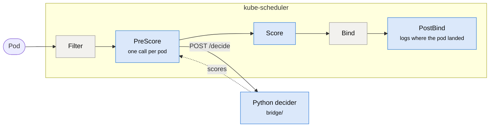
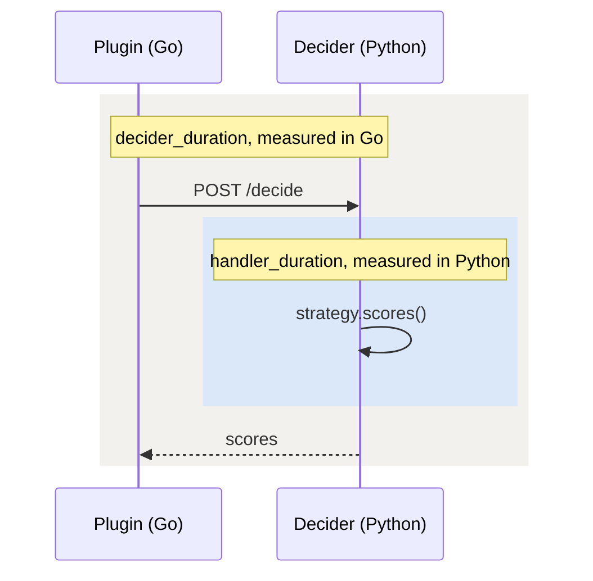

# How Kaptain works

A Go plugin inside kube-scheduler asks a Python decider where to place each pod. Every policy
is written in Python, so adding one needs no Go change. Built against Kubernetes v1.31.0.



Blue: Kaptain. Grey: Kubernetes, untouched.

- **We only score.** Kubernetes still filters and binds.
- **A failure is visible.** If the decider crashes, times out or answers badly, the plugin falls
  back to the node with the most free CPU and logs it as a fallback.
- **The log says where the pod really landed**, since kube-scheduler breaks ties at random.

## The policies

All in `bridge/strategies/`, one file each.

| Policy | Picks the node |
|---|---|
| `least-allocated` | with the most unrequested CPU and memory |
| `shortest-estimate` | where the task's estimated runtime is shortest |
| `earliest-finish` | where the estimate plus the work already there, shared over the cores, is shortest |
| `slowed-estimate-fixed`, `-learned` | where the estimate, slowed by the node's load, is shortest |
| `kaptain` | chosen by a network trained with PPO, which scores any number of nodes |

Kaptain's suffixes: `-b0.5` adds the CPU used to the cost, `-l4` adds a shaping bonus,
`-llm` takes that bonus from an LLM, `-placebo` draws it at random, `-pod` rewards each
decision for the pod it placed instead of for the whole cluster, and `-ef` starts the
network from earliest-finish.

## Timers



The difference between the two is the cost of the call itself, not of the policy.

## Run it locally

Needs Docker, `kind`, `kubectl` and `uv`.

```bash
make all-plugin      # kind cluster, both images, deploy, a demo pod
make verify-plugin   # where the pod landed
make logs-plugin     # one JSON line per decision
make check           # gofmt, go vet, manifests
make down
```

`kind` puts every node on one machine: fine to test the wiring, not to measure placement. To
change policy, set `STRATEGY` in `k8s/decider.yaml` and `KAPTAIN_STRATEGY` in
`k8s/scheduler-plugin.yaml`, then apply both.

## Layout

```
plugin/    the Go plugin
bridge/    the Python decider and its policies
k8s/       manifests
workloads/ the experiments and the tools that run them
```
