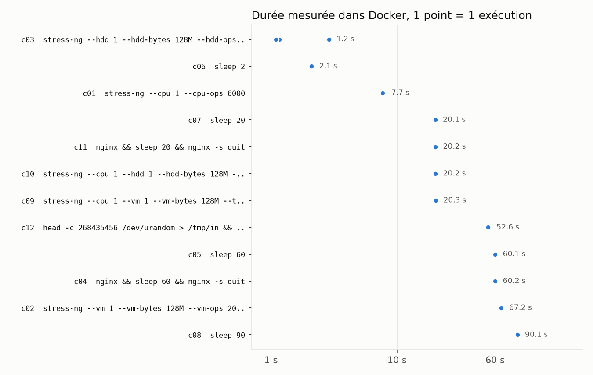
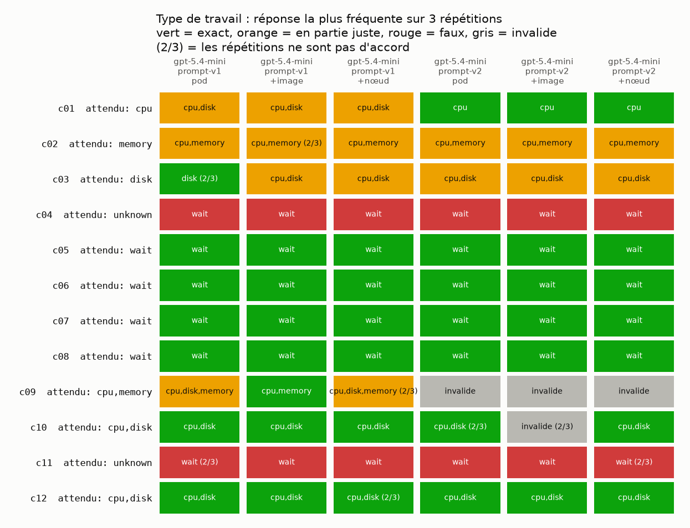
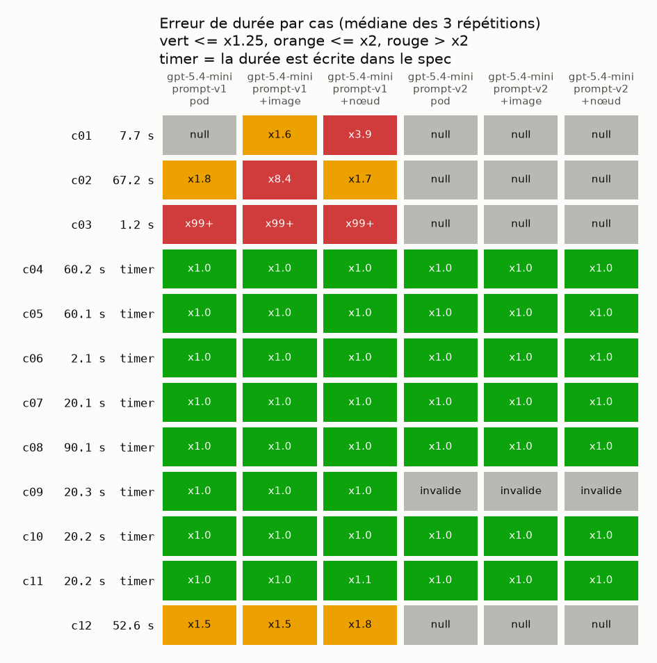
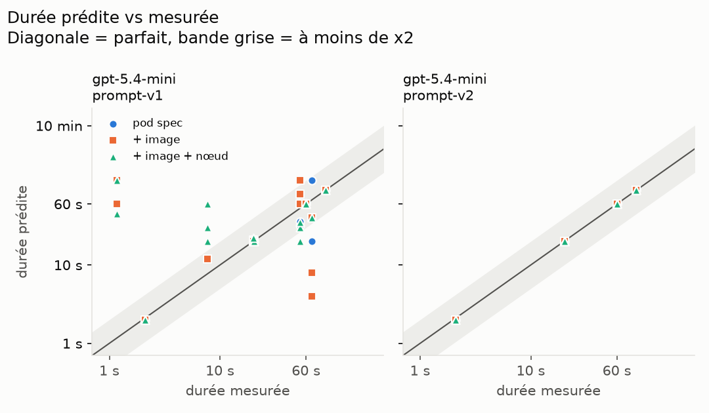
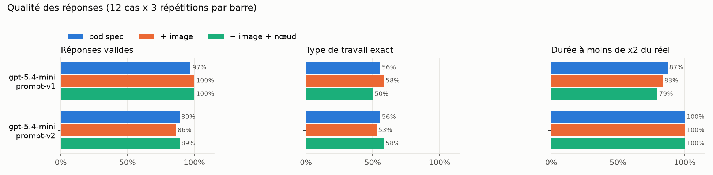
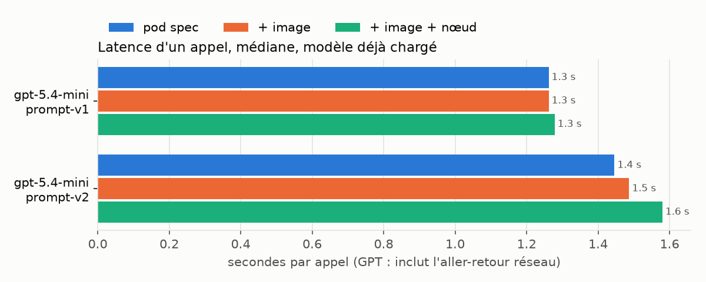

# Tagging de tâches par LLM avant lancement : synthèse

**Question.** À partir de ce qu'un scheduler Kubernetes sait *avant* de lancer un pod,
un LLM peut-il dire (1) quel type de travail fait la tâche et (2) combien de temps elle dure ?
Et est-ce que lui donner plus de contexte (image, nœud) l'aide ?

**Réponse courte : non, pas de façon utile.**

- **Classification** : 50 à 58 % de types exacts, sur des cas pourtant faciles (la commande
  dit ce qu'elle fait). Les erreurs sont systématiques et changer le prompt les déplace
  sans les supprimer.
- **Durée** : le modèle ne fait pas mieux que lire un timer écrit dans la commande
  (`sleep 60`, `--timeout 20s`). Sans timer, il se trompe jusqu'à un facteur 100 (prompt v1)
  ou refuse de répondre (prompt v2).
- **Plus de contexte** : ajouter l'image puis le nœud n'améliore ni la classification
  ni la durée. Ça coûte plus de tokens et une requête de plus au registre.
- **Latence** : 1,3 à 1,6 s par appel, alors qu'une décision de scheduling se compte en millisecondes.

Pilote de 12 cas, un modèle (`gpt-5.4-mini`), deux prompts, 216 appels, 0,26 $ au total.
Protocole détaillé : [../llm-tagging-protocol.md](../llm-tagging-protocol.md).
Historique des décisions : [../llm-tagging-notes.md](../llm-tagging-notes.md).

---

## 1. Démarche

```
 cases.json ──► pod spec ─────────────┐
 images.json ─► métadonnées d'image ──┼─► entrée JSON ─► LLM ─► réponse JSON ─┐
 node.json ───► nœud candidat ────────┘   (3 niveaux)    (prompt + schéma)    │
                                                                              ▼
 references.json (types attendus) ───────────────────────────────────► comparaison
 measurements.json (durée réelle mesurée dans Docker) ──────────────►  (report.py, plots.py)
```

1. On écrit 12 pods de test (section 2.1).
2. On mesure ce que chacun fait réellement : on l'exécute 3 fois dans Docker avec ses limites
   CPU/mémoire et on relève durée, CPU, mémoire et I/O (`measure.py`).
3. On donne au LLM uniquement ce que le scheduler a au moment de choisir un nœud,
   à trois niveaux de contexte (section 2.2).
4. Le LLM rend des types de travail et une durée dans un JSON imposé (section 3).
5. On compare aux types attendus (`references.json`) et aux durées mesurées (section 4).

Chaque combinaison cas × niveau est appelée 3 fois (12 × 3 × 3 = 108 appels par run),
dans un ordre mélangé, chaque appel avec un contexte neuf.

## 2. Ce que le modèle reçoit

### 2.1 Les 12 cas

Ils viennent des workloads de la PR #28 (`workloads/pods/`) ou en sont des variantes.

| Cas | Commande (sans `--temp-path /tmp --metrics-brief`) | Limites | Durée mesurée | Durée écrite dans la commande ? |
|---|---|---|---|---|
| c01 | `stress-ng --cpu 1 --cpu-ops 6000` | 500m / 64Mi | 7,7 s | non |
| c02 | `stress-ng --vm 1 --vm-bytes 128M --vm-ops 2000000` | 500m / 256Mi | 67,2 s | non |
| c03 | `stress-ng --hdd 1 --hdd-bytes 128M --hdd-ops 20000` | 500m / 256Mi | 1,2 s | non |
| c04 | `nginx && sleep 60 && nginx -s quit` | | 60,2 s | oui |
| c05 | `sleep 60` | | 60,1 s | oui |
| c06 | `sleep 2` | | 2,1 s | oui |
| c07 | `sleep 20` | | 20,1 s | oui |
| c08 | `sleep 90` | | 90,1 s | oui |
| c09 | `stress-ng --cpu 1 --vm 1 --vm-bytes 128M --timeout 20s` | | 20,3 s | oui |
| c10 | `stress-ng --cpu 1 --hdd 1 --hdd-bytes 128M --timeout 20s` | | 20,2 s | oui |
| c11 | `nginx && sleep 20 && nginx -s quit` | | 20,2 s | oui |
| c12 | `head -c 268435456 /dev/urandom > /tmp/in && gzip -c /tmp/in > /tmp/in.gz` | | 52,6 s | non |

**8 cas sur 12 ont leur durée écrite dans la commande.** Seuls c01, c02, c03 et c12
testent vraiment l'estimation de durée.



### 2.2 Les trois niveaux de contexte

| Niveau | Contenu envoyé | Coût pour l'obtenir | Tokens d'entrée (v1) |
|---|---|---|---|
| `pod` | Le pod spec | Aucun : c'est l'objet que reçoit le scheduler | ~705 |
| `pod_image` | + la config de chaque image, lue sur le registre sans télécharger les couches | ~0,4 s par image (`images.py`) | ~960 |
| `pod_image_node` | + le nœud candidat, sous forme d'objet Node Kubernetes | Un appel par nœud candidat | ~1 110 |

On retire du pod spec tout ce qui pourrait trahir la réponse : `metadata` (nom, labels comme
`kaptain.io/workload`) et `schedulerName`. Le reste est envoyé tel quel.

**Niveau `pod`**, exemple exact pour c01 (`securityContext` abrégé) :

```json
{"pod": {"apiVersion": "v1", "kind": "Pod", "spec": {
  "activeDeadlineSeconds": 3600,
  "automountServiceAccountToken": false,
  "restartPolicy": "Never",
  "containers": [{
    "name": "work",
    "image": "ghcr.io/colinianking/stress-ng@sha256:cf90385b…",
    "command": ["stress-ng", "--cpu", "1", "--cpu-ops", "6000", "--temp-path", "/tmp", "--metrics-brief"],
    "resources": {"limits":   {"cpu": "500m", "memory": "64Mi"},
                  "requests": {"cpu": "500m", "memory": "64Mi"}},
    "securityContext": {"allowPrivilegeEscalation": false, "capabilities": {"drop": ["ALL"]}}}],
  "securityContext": {"runAsNonRoot": true, "runAsUser": 65534, "runAsGroup": 65534,
                      "seccompProfile": {"type": "RuntimeDefault"}}}}}
```

**Niveau `pod_image`**, on ajoute une clé `images` :

```json
"images": {"ghcr.io/colinianking/stress-ng@sha256:cf90385b…": {
  "architecture": "amd64", "os": "linux",
  "compressed_size_bytes": 55729325, "layer_count": 2,
  "entrypoint": ["/usr/bin/stress-ng"], "cmd": ["--help"],
  "env": ["PATH=/usr/local/sbin:/usr/local/bin:/usr/sbin:/usr/bin:/sbin:/bin"],
  "exposed_ports": [], "working_dir": null, "user": null,
  "history": ["# debian.sh --arch 'amd64' out/ 'trixie' '@1789689600'",
              "COPY stress-ng/install-root/ / # buildkit",
              "ENTRYPOINT [\"/usr/bin/stress-ng\"]", "CMD [\"--help\"]"]}}
```

**Niveau `pod_image_node`**, on ajoute une clé `node`, la machine où les mesures ont été faites.
Les deux labels `hardware/*` ne sont pas standard : c'est le genre de label qu'un admin ou
node-feature-discovery ajoute.

```json
"node": {"apiVersion": "v1", "kind": "Node",
  "metadata": {"labels": {"kubernetes.io/arch": "amd64", "kubernetes.io/os": "linux",
                          "hardware/cpu-model": "AMD Ryzen 7 2700X", "hardware/disk": "nvme-ssd"}},
  "status": {"capacity":    {"cpu": "16", "memory": "15393Mi"},
             "allocatable": {"cpu": "16", "memory": "15393Mi"},
             "nodeInfo": {"architecture": "amd64", "operatingSystem": "linux",
                          "kernelVersion": "7.0.0-38-generic", "containerRuntimeVersion": "docker"}}}
```

Le modèle ne reçoit **jamais** l'identifiant du cas, la référence ou la mesure.

### 2.3 Le prompt système

Envoyé en message `system`. Le JSON de la section 2.2 est envoyé en message `user`.
Deux versions ont été testées :

- [`prompt.txt`](prompt.txt) (**v1**) : définit les 6 tags et donne des règles de tagging
  (« les requests/limits ne prouvent pas le travail », « wait et unknown sont toujours seuls »,
  « un serveur web idle n'est pas du réseau »). Pour la durée, il demande une estimation en
  secondes en tenant compte des limites et du nœud, et `null` « seulement sans aucune base ».
- [`prompt-v2.txt`](prompt-v2.txt) (**v2**) : trois changements, choisis après lecture des
  réponses v1.
  1. Le modèle écrit sa justification (`evidence`, `missing_information`) **avant** sa réponse.
  2. Une règle : les options qui ne nomment qu'un emplacement ou un format (dossier temporaire,
     flag de log ou de métriques) ne sont pas du travail disque.
  3. Pour la durée : utiliser un timer s'il est écrit, sinon répondre `null` si la quantité de
     travail ne peut pas être convertie en temps sur ce matériel, plutôt que deviner.

Réglages communs : `gpt-5.4-mini` via l'API Responses, raisonnement désactivé
(`reasoning.effort: none`), 300 tokens de sortie max, sortie contrainte par schéma JSON strict.

## 3. Ce que le modèle rend

Un JSON imposé par [`response_schema.json`](response_schema.json)
(v2 : [`response_schema-v2.json`](response_schema-v2.json), mêmes champs dans un autre ordre) :

| Champ | Contenu |
|---|---|
| `work_types` | Un ou plusieurs de `cpu`, `memory`, `disk`, `network` ; ou `wait` seul ; ou `unknown` seul |
| `duration_seconds` | Durée estimée du processus, en secondes, ou `null` |
| `evidence` | Au plus 3 phrases courtes citant l'entrée |
| `missing_information` | Au plus 3 informations qui manquent |

Une réponse qui viole les règles (par exemple `wait` combiné à `cpu`) est comptée **invalide**,
donc fausse.

Exemple réel, c01 au niveau `pod_image_node`, prompt v1 (durée réelle : 7,7 s) :

```json
{"work_types": ["cpu", "disk"], "duration_seconds": 60,
 "evidence": ["Container command: `stress-ng --cpu 1 --cpu-ops 6000 --temp-path /tmp --metrics-brief`",
              "Image entrypoint is `/usr/bin/stress-ng`",
              "Node has `nvme-ssd`; pod sets `--temp-path /tmp`"],
 "missing_information": ["Exact stress-ng worker type details beyond CPU ops",
                         "Whether `/tmp` will be heavily used by this specific stress-ng mode",
                         "Expected completion timing under the 500m CPU limit"]}
```

Le même cas avec le prompt v2 : `["cpu"]`, durée `null`, avec
*« Exact `stress-ng` throughput on this node »* parmi les informations manquantes.

## 4. Vérité terrain et métriques

- **Types attendus** ([`references.json`](references.json)) : déduits de la construction de
  chaque cas. Ce sont **des références provisoires, pas encore relues**. En particulier,
  nginx sans trafic (c04, c11) attend `unknown`, mais `wait` se défend (voir 5.2).
- **Durées réelles** ([`measurements.json`](measurements.json)) : médiane de 3 exécutions
  Docker sur un Ryzen 7 2700X, avec les limites du pod.

| Métrique | Définition |
|---|---|
| Type exact | L'ensemble des tags est exactement celui attendu |
| Précision / rappel par tag | Calculés sur les réponses valides |
| Facteur d'erreur de durée | `max(prédit / mesuré, mesuré / prédit)` : ×1 parfait, ×2 = deux fois trop long ou trop court |
| Dans ×1,25 / dans ×2 | Part des estimations chiffrées sous ce facteur (les `null` sont exclus et comptés à part) |
| Latence | Temps de l'appel API côté client, aller-retour réseau compris |

## 5. Résultats : classification

| Run | Niveau | Réponses valides | Type exact | Type exact si nginx = `wait` |
|---|---|---|---|---|
| prompt v1 | `pod` | 35/36 | 56 % | 69 % |
| prompt v1 | `pod_image` | 36/36 | 58 % | 75 % |
| prompt v1 | `pod_image_node` | 36/36 | 50 % | 67 % |
| prompt v2 | `pod` | 32/36 | 56 % | 72 % |
| prompt v2 | `pod_image` | 31/36 | 53 % | 69 % |
| prompt v2 | `pod_image_node` | 32/36 | 58 % | 72 % |



### 5.1 Ce qui marche

Les cas où la commande est explicite et sans ambiguïté : `sleep N` → `wait` (c05 à c08),
`stress-ng --cpu --hdd` → `cpu,disk` (c10), `head /dev/urandom | gzip` → `cpu,disk` (c12).

### 5.2 Les erreurs, par type

1. **Tags en trop.** Le modèle ajoute `cpu` au stress mémoire (c02) et au stress disque (c03)
   dans presque toutes les réponses, malgré la consigne explicite du prompt
   (*« A memory stressor's incidental computation does not alone warrant cpu »*).
2. **Un flag pris pour du travail.** En v1, l'option `--temp-path /tmp` (présente dans tous les
   pods stress-ng) déclenche `disk` : c01 devient `cpu,disk`. Le modèle le cite lui-même comme
   preuve. La règle ajoutée en v2 corrige ça : la précision de `disk` passe de 60–69 % à 100 %,
   et c01 devient exact.
3. **Un nouveau défaut en v2.** Sur c09 et c10 (`--timeout 20s`), le modèle ajoute `wait` à
   `cpu,memory` ou `cpu,disk`, ce qui est interdit. c09 est invalide sur les 9 appels. C'est probablement un
   effet de la nouvelle consigne sur les timers, mais ça n'a pas été vérifié.
4. **`unknown` n'est jamais utilisé** : ni par gpt-5.4-mini (216 appels), ni par qwen3 1.7B/4B/8B
   lors des premiers essais (voir les notes). Pour nginx sans trafic (c04, c11), le modèle
   répond `wait`. Vu la commande (`nginx && sleep 60 && nginx -s quit`), c'est défendable, et
   c'est plutôt la référence qui est discutable.

**Bilan classification.** Au mieux environ 70 % si on accepte `wait` pour nginx, sur des cas
écrits pour être lisibles. Chaque correction du prompt a réglé une erreur et en a créé une autre.
Le prompt v2 a été corrigé en regardant ces mêmes 12 cas, donc ses scores sont plutôt optimistes.

## 6. Résultats : durée

### 6.1 Avec ou sans timer dans la commande

| Run | Niveau | Avec timer (8 cas) : médiane, dans ×2 | Sans timer (4 cas) : médiane, dans ×2 | Sans timer : `null` |
|---|---|---|---|---|
| prompt v1 | `pod` | ×1,01, 100 % | ×2,03, 50 % | 4/12 |
| prompt v1 | `pod_image` | ×1,01, 100 % | ×1,98, 50 % | 0/12 |
| prompt v1 | `pod_image_node` | ×1,01, 100 % | ×3,25, 30 % | 2/12 |
| prompt v2 | tous niveaux | ×1,00, 100 % | aucune estimation | 12/12 |



- **Avec timer**, le modèle recopie le nombre. Une expression régulière sur `sleep N` et
  `--timeout` ferait pareil en quelques microsecondes, gratuitement.
- **Sans timer, prompt v1** : le modèle devine. c03 dure 1,2 s et il annonce 45 à 120 s (×99+).
  c02 dure 67 s et il annonce 4 à 120 s selon la répétition. Seul c12 (×1,5 à ×1,8 en médiane) est
  correct à chaque niveau.
- **Sans timer, prompt v2** : autorisé à s'abstenir, il s'abstient sur les 4 cas, à tous les
  niveaux. C'est plus honnête mais ça n'apporte rien de plus qu'un parseur de timers.



À gauche (v1), les points hors de la bande grise sont tous des cas sans timer. À droite (v2),
il ne reste que les cas avec timer, tous sur la diagonale.

**Pourquoi.** Passer de `--hdd-ops 20000` ou `--cpu-ops 6000` à des secondes demande de
connaître le débit réel de ce programme sur cette machine. Cette information n'est ni dans le
pod spec, ni dans l'image, ni dans la description du nœud. Le modèle le dit lui-même dans
`missing_information` (*« Expected ops-to-time mapping under the 500m CPU limit »*). Un meilleur
modèle ou un meilleur prompt ne créera pas cette information.

## 7. Effet du contexte (pod → + image → + nœud)

| Niveau | Type exact v1 / v2 | Sans timer dans ×2 (v1) | Tokens d'entrée (v1) | Latence médiane v1 / v2 |
|---|---|---|---|---|
| `pod` | 56 % / 56 % | 50 % | ~705 | 1,26 s / 1,45 s |
| `pod_image` | 58 % / 53 % | 50 % | ~960 | 1,26 s / 1,49 s |
| `pod_image_node` | 50 % / 58 % | 30 % | ~1 110 | 1,28 s / 1,58 s |



- **L'image n'apporte rien** : les commandes sont déjà dans le pod spec. L'entrypoint
  `/usr/bin/stress-ng` ne dit rien de plus que `command: ["stress-ng", …]`.
- **Le nœud n'aide pas, il gêne parfois.** Pour la durée sans timer en v1, on passe de 50 % à
  30 % dans ×2. Pour c01, le label `hardware/disk: nvme-ssd` est cité comme preuve d'un travail disque.
- Les écarts entre niveaux (quelques points) sont de l'ordre du bruit entre répétitions :
  sur 36 appels, une réponse vaut 3 points.
- En contrepartie, chaque niveau coûte plus de tokens. Le niveau `pod_image` demande ~0,4 s de
  requête au registre par image. Le niveau `pod_image_node` demande un appel par nœud candidat.

## 8. Latence et coût



| Run | Appels | Coût | Coût par appel | Latence médiane | p90 |
|---|---|---|---|---|---|
| prompt v1 | 108 | 0,123 $ | ~0,0011 $ | 1,26–1,28 s | 1,45–1,54 s |
| prompt v2 | 108 | 0,139 $ | ~0,0013 $ | 1,45–1,58 s | 1,67–1,77 s |

Le prompt v2 est plus lent : le modèle écrit sa justification avant de répondre.
Plus d'une seconde par appel, c'est incompatible avec un appel dans la boucle de scheduling.
Ça ne reste envisageable que hors ligne, avec un résultat mis en cache par image.

## 9. Limites

- **12 cas** dont **4 seulement sans timer** : c'est un pilote, pas une preuve.
- Les cas sont **faciles** : stress-ng, `sleep`, `gzip` disent ce qu'ils font. Des vrais jobs
  opaques (une image maison, un `python main.py`) seraient plus durs, pas plus faciles.
- **Un seul modèle**, raisonnement désactivé. Le raisonnement ou un modèle plus gros pourrait
  améliorer la classification. Pour la durée, l'information manque dans l'entrée, donc ça ne
  devrait pas changer la conclusion.
- **Références provisoires**, écrites par Claude et pas encore relues. La plus discutable est
  `unknown` pour nginx.
- Le **prompt v2** a été ajusté sur ces mêmes cas : il n'y a pas de jeu de test séparé.
- Mesures sur **une seule machine** (Ryzen 7 2700X), dans Docker et non dans Kubernetes,
  avec un cgroup lu toutes les 0,2 s.
- En v1 et v2, une réponse invalide coûte quand même son appel. Le runner s'arrête seulement
  si un appel payant échoue.

## 10. Conclusion

Avec les seules informations disponibles au moment du scheduling :

1. **Classer le type de travail** avec un LLM donne des résultats médiocres (≈ 55 %, ≈ 70 % avec
   une référence plus souple) même sur des cas explicites. Les erreurs sont systématiques (tags
   en trop, `unknown` jamais utilisé) et résistent aux corrections du prompt.
2. **Estimer la durée** n'est pas viable : le LLM ne fait pas mieux qu'un parseur de timers,
   parce que l'information nécessaire (le débit du programme sur la machine) n'est pas dans l'entrée.
3. **Ajouter du contexte** (image, nœud) n'améliore rien et coûte en tokens, en latence et en
   requêtes.
4. **La latence** (> 1 s) exclut un appel par décision de scheduling.

Si on garde une piste LLM, ce serait un tag calculé **une fois par image, hors ligne, mis en
cache**, et utilisé comme une feature parmi d'autres. Pour la durée, la source réaliste reste
**l'historique d'exécution** de tâches similaires, comme le fait déjà `cluster_analyze/`.

## 11. Reproduire

Python standard uniquement, sans connexion à Kubernetes. matplotlib n'est nécessaire que pour
les graphiques.

```bash
python3 images.py                         # métadonnées d'image depuis le registre, ~0,4 s par image
python3 measure.py --repeats 3            # ~25 min, Docker, rien d'autre ne doit tourner
python3 -m unittest test_tagging

export OPENAI_API_KEY=...
# prompt v1 (s'arrête avant de dépasser le budget)
python3 tag.py --provider openai --model gpt-5.4-mini --budget-usd 1 --input-price 0.75 --output-price 4.50
# prompt v2
python3 tag.py --provider openai --model gpt-5.4-mini --budget-usd 1 --input-price 0.75 --output-price 4.50 \
    --prompt prompt-v2.txt --schema response_schema-v2.json --out results/gpt-5.4-mini-prompt-v2
# en local avec Ollama
python3 tag.py --model qwen3:4b

python3 report.py results/A results/B     # tableau de comparaison
uv run --no-project --with matplotlib python plots.py results/A results/B   # PNG dans results/figures/
```

`results/` n'est pas versionné. Les graphiques de ce README sont copiés dans `figures/`.
Ils viennent des runs `gpt-5.4-mini-20261009-175426` (v1) et `gpt-5.4-mini-prompt-v2` (v2)
du 9 octobre 2026.
`tag.py` copie dans chaque dossier de résultat le prompt, le schéma, les cas, les références
et les mesures utilisés, donc chaque run reste lisible après coup.
